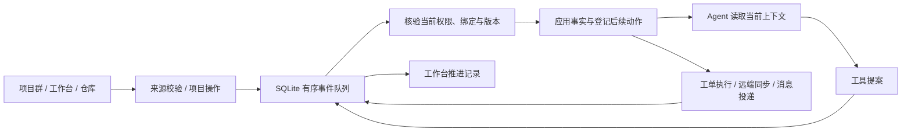

# Super-Org 架构设计

Super-Org 以项目为协作单位。团队从讨论中形成阶段目标和行动项，随着证据更新计划。Agent 负责整理、执行和跟进，成员决定目标、开工范围与交付验收。工作台与群聊都以同一份持久状态为准。

## 项目模型

| 对象 | 职责 |
| --- | --- |
| 项目 | 当前目标、状态、成员、里程碑和决定，可关联钉钉群和 GitHub 仓库 |
| 任务 | 可验收的行动项，包含执行方式、负责人、依赖、验收条件及可选 Issue / PR |
| 工单 | 一次 Agent 执行及其上下文、报告、阻塞问题和后续输入。一条任务可以保留历史执行，跟进交给当前工单 |
| 交付与验收 | 本版证据及验收条件快照，保存验收人、通过或退回的决定 |
| 事件 | 来源提供或领域操作产生的持久事实，带顺序和因果关系 |
| 回执 | 工具、远端同步和消息投递的真实结果，与触发事件关联 |

项目可从待开工进入活跃，也可以暂停或归档。任务的主要路径是待办、进行中、待验收、完成，另有取消。退回允许继续修订并提交后续版，旧版本的引用始终指向原交付。执行成功、PR 合并、Issue 关闭和人工验收分别是独立事实。

## 从事实到行动

- **接入与注册。** 外部来源通过 `SourceKind` 注册自己的协议、上下文、投递能力及项目事件。GitHub、钉钉、飞书、本地请求各有一个入口文件。仓库适配器复用 `RepositorySource` 的资源筛选、游标与发布机制。 [事件源适配](source-adapters.zh-CN.md)
- **排序与应用。** `ProjectEvents` 按 SQLite 入队序号应用事实，去重后在事务内提交业务状态、应用结果和待办动作。外部时间用于判断数据新旧，队列序号决定系统看到的顺序。
- **推理与授权。** 需要判断时唤起所选 Agent。系统反应声明允许的工具和任务范围，Agent 根据原文、当前快照和实际结果选择操作、答疑或澄清。提案重新入队，执行前再次核验权限及版本。发生冲突时以新状态为准。
- **副作用与恢复。** 模型推理、执行和网络请求在事务外处理。Effects 和 Outbox 持久记录待处理工作，重启后恢复，结果再进入记录。不同平台的发送保证取决于其接口。
- **主动跟进。** 任务就绪、阻塞与预约到期分别产生事实。系统按最近到期预约设置计时器，事件到达后才唤起 Agent。项目的自动推进授权控制新的自主行动，停用后仍可由成员主动操作。 [自主跟进](events/follow-up.zh-CN.md)

项目、成员、工作记录、事件队列和回执共享 `orchestrator.sqlite`。工单目录和模型会话还依赖运行目录与 Agent 本机状态。工作台用事件、提案和回执的因果 ID 建立「推进记录」，区分登记、实际执行和投递结果。 [推进记录与迁移](events/project-history.zh-CN.md)

## 主要代码入口

| 领域 | 入口 |
| --- | --- |
| 独立进程和本地项目管理 | [codex-cli.ts](../src/codex-cli.ts)、[http.ts](../src/app/http.ts) |
| 项目与成员数据、首次会议 | [projects.ts](../src/app/projects.ts)、[project-planning.ts](../src/app/project-planning.ts) |
| 事件队列与 Agent 工具循环 | [project-events.ts](../src/app/project-events.ts)、[project-agent.ts](../src/app/project-agent.ts)、[project-tools.ts](../src/app/project-tools.ts) |
| 自主推进与交付 | [project-progress.ts](../src/app/project-progress.ts)、[delivery-ready.ts](../src/app/events/delivery-ready.ts)、[project-reviews.ts](../src/app/project-reviews.ts) |
| 仓库关联及反馈同步 | [project-repository.ts](../src/app/project-repository.ts)、[repository-delivery.ts](../src/app/repository-delivery.ts) |
| 数据与推进记录 | [store.ts](../src/app/store.ts)、[project-history.ts](../src/app/project-history.ts) |
| Agent 运行与来源接入 | [robot-agents.ts](../src/harness/robot-agents.ts)、[registry.ts](../src/sources/registry.ts) |

项目任务复用原型的执行、授权、消息投递与持久化基础。原型内部契约的背景见[上游设计](https://github.com/deepseek-ai/dsh-superagent-prototype/tree/main/docs)。本仓库维护项目层及与运行时的衔接。
