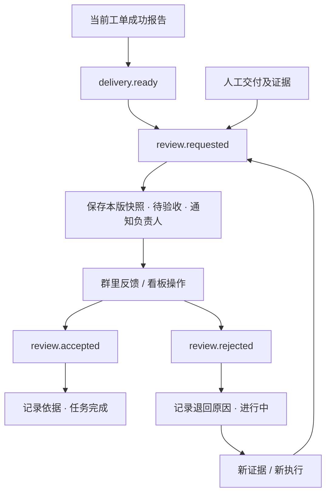

# 项目事件配置

项目事件由 SuperAgent 后台消费。队列写在现有 SQLite 的 `project_event` 表中，按入队序号处理。队列空闲时保持等待，入队后自动唤醒，消费事件无需调用模型。耗时工作通过已有 `Effects` 和 `Outbox` 继续执行。

## 统一 JSON

默认配置见 [project-workflow.defaults.json](../../config/project-workflow.defaults.json)。空对象也有效，事件采用各自内置的默认值。

```json
{
  "sources": {},
  "on": {}
}
```

`sources` 的键是已安装的事件源名称。每个来源可用 `enabled` 开关监听结果的处理，用 `watch` 选择适配器提供的类别。省略时采用来源默认行为。`on` 的键是事件名，布尔值开关其反应。支持 Agent 指导的事件还可以用自然语言字符串覆盖内置指导。每个实际接入的事件都有自己的默认配置和说明，查询 API 同时返回可用类别、事件说明和有效默认值。

配置只控制新项目事件的处理，已有消息通道的登录和连接设置继续由来源设置管理。停用的事件仍留时间线，显示 `ignored`，重新启用后处理新到达的事件。历史记录保留原处理结果。

## 已接入的事件

| 事件 | 默认值 | 配置说明 |
| --- | --- | --- |
| `code.change.observed` | 开启 | [代码交付事实](code-change-observed.zh-CN.md)，核验真实 PR 合并与报告，保留代码快照 |
| `issue.observed` | 开启 | [Issue 状态](issue-observed.zh-CN.md)，记录远端关闭及重开，不代替人工验收 |
| `issue.close.requested` | 开启 | [验收后同步](issue-close-requested.zh-CN.md)，仅关闭任务明确负责解决的 Issue，保留失败及重试结果 |
| `delivery.ready` | 开启 | [工单交付就绪](delivery-ready.zh-CN.md)，成功交付后移到待验收并通知任务负责人 |
| `task.ready` | 开启，附默认 Agent 指导 | [就绪与依赖解除](task-ready.zh-CN.md)，授权后唤起 Agent 判断如何推进 |
| `check.due` | 开启，附默认 Agent 指导 | [预约检查](check-due.zh-CN.md)，持久化的一次性时间事件，空闲时不调用模型 |
| `task.blocked` | 开启，附默认 Agent 指导 | [工单受阻与待回答](task-blocked.zh-CN.md)，向项目群通知实际阻塞原因及问题 |
| `conversation.preferences.update_requested` | 开启 | [会话沟通偏好](conversation-preferences.zh-CN.md)，持久保存格式和风格，通过统一输出层执行 |
| `project.message.received` | 开启，附默认 Agent 指导 | [项目消息](project-message.zh-CN.md)，结合原文和引用组合[项目工具](project-tools.zh-CN.md)处理，并回复实际结果 |
| `review.requested` | 开启 | [请求验收](review-requested.zh-CN.md)，保存交付快照并通知负责人 |
| `review.accepted` | 开启 | [验收通过](review-accepted.zh-CN.md)，核对当前版本与负责人，记录依据并完成任务 |
| `review.rejected` | 开启 | [退回交付](review-rejected.zh-CN.md)，保留原因及历史，等待新交付 |

## 读取与保存

交付与验收共用下列事件。队列按序确认事实，群里的自然语言由所选 Agent 判断后调用工具，网页使用同一事件入口。



完整服务提供以下本地管理 API。请求头沿用 `X-Orchestrator-Request: 1`，地址使用当前服务端口。

| 接口 | 内容 |
| --- | --- |
| `GET /orchestrator/api/projects/workflow` | 返回配置、配置修订、已安装事件源与事件默认值 |
| `PUT /orchestrator/api/projects/workflow` | 提交 `{"revision":0,"config":{}}`，整份替换配置。未填写部分恢复默认值 |
| `GET /orchestrator/api/projects/:id/checks` | 当前任务检查预约、原因、时间及到期标识 |
| `GET /orchestrator/api/projects/:id/agent-runs` | 用户消息与系统事实唤起的 Agent 记录、工具调用及实际结果 |
| `GET /orchestrator/api/projects/events` | 最近 50 条事件，支持 `projectId` 过滤和 `limit`，最多 200 条 |

保存时使用读取到的 `revision`，并发覆盖返回 409。未知来源、类别、事件和配置字段返回错误。更换适配器时，产生同一事件定义的来源可以继续使用相同的 `on` 配置。事件仅由已注册来源通过绑定的发布入口写入，网页管理接口提供配置与查询。

## 开发接入

来源通过 `SourceKind.projectEvents` 声明事件的类别、数据校验、默认反应和文档路径。来源运行时用 `SourceContext.projectEvents.publish()` 发布，发布身份绑定来源。服务端用 `ProjectEvents.handle()` 注册同步处理器。处理器在一个事务内写入状态和待执行动作，异步 API 或模型调用必须入 `Effects`。

原生事件 ID 在来源内唯一。同 ID 同内容返回原记录，同 ID 不同内容返回冲突。不同来源可使用相同原生 ID。处理失败回滚状态和该次入队的动作，后续事件等待同一项重试。启动恢复检查 SQLite 的待处理记录，也能恢复提交后丢失的进程内唤醒。

事件数据版本由适配器声明，默认是 1，发布时和事件一起存入数据库。配置 JSON 使用业务选项。缺少匹配版本的处理器时保留待处理记录并通过队列健康状态报告原因。

自主跟进须项目 active 且 autoAdvance=true。项目扫描直接派发已由事实唤起 Agent 的反应替代，设计见[自主跟进](autonomous-follow-up.zh-CN.md)。验收后的 Issue 同步与[看板推进记录和存量兼容](project-history.zh-CN.md)均已接入。每阶段完成后在 [验收记录](acceptance.zh-CN.md) 中登记结果。
