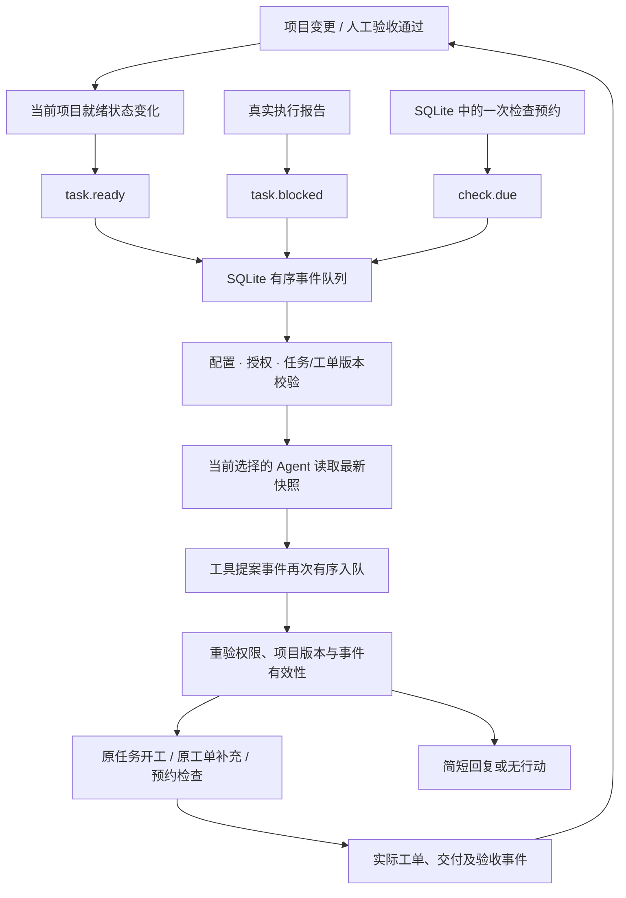

# 自主跟进与后续推进

任务 4 用事实唤起现有 Agent 工具循环，替换项目扫描中的自动派工。没有新增一套意图匹配器或独立管理 Agent，也不改变人工验收的权责。



## 模块与边界

| 模块 | 职责 |
| --- | --- |
| Store 聚合观察 | 项目写入/删除与派生事实在同一事务；回滚不留下孤立事件 |
| ProjectProgress | 仅响应本次项目变更，发布就绪事实；保存一次检查预约，恢复最近到期计时器 |
| ProjectEvents | 全局有序事实、配置和去重；应用事实时事务登记 Agent 动作 |
| ProjectAgent | 人类消息和系统事实共用模型与工具循环；系统反应保存原始事件，不冒充成员 |
| ProjectTools / Projects / Engine | 权限、任务归属、依赖和已有工单保护；执行复用既有入口 |
| Communication / Outbox | 沟通偏好、Markdown、精简输出、真实 @ 和发送重试 |

系统反应工具仅开放 project.inspect、runtime.inspect、task.start、task.follow_up、follow_up.schedule/cancel，并限制到触发事件的任务。不开放目标、分工或人工验收修改；字符串配置也不能突破服务端约束。

事件决定“为什么现在看这项任务”，AI 决定“根据最新证据应该做什么”。默认指导可以替换，但配置不需要描述 GitHub 原生 webhook 字段或编写动作规则。所有实际工具调用和结果都可追溯。

## 默认配置

空配置继续有效：采用三个事件的内置默认值。需要明确写出时：

```json
{
  "on": {
    "task.ready": true,
    "task.blocked": true,
    "check.due": true
  }
}
```

此配置与其他事件选项合并后，通过 workflow API 及当前 revision 保存。独立默认 JSON 与配置说明分别为[任务就绪](task-ready.zh-CN.md)、[阻塞跟进](task-blocked.zh-CN.md)、[预约检查](check-due.zh-CN.md)。项目仍须 active 且 autoAdvance=true。关闭自动推进不会阻止已授权的直接人工操作，也不会撤销正在执行的 Worker；只停止新的自主跟进行动。

## 顺序、去重和失效

- 事实按 SQLite 入队序号处理，推理及网络工作留在 Effects，避免慢模型阻塞事实消费。
- 推理读快照，工具提案重新排入同一有序队列；版本冲突先重读，不能用旧判断覆盖新状态。
- 就绪轮次有持久身份；任务启动仍由领域层检查已有工单。同一阻塞轮次只反应一次；检查替换/取消后旧检查即失效。
- 项目暂停、关闭自动推进、范围与依赖变化、群绑定改变或任务删除，会在落地前撤销旧系统反应。
- 有实际变更时回复结果；只有读取且无新信息时可以安静。没有有效预约和新事实时不调用模型。
- 重启仅做一次持久状态恢复；后续依靠聚合变化和时间到达，不恢复旧的每轮项目扫描派工。

本模块不实现 GitHub 自动关闭 Issue、PR 创建/合并、原生审批桥接或无人确认的验收。具体交付事实仍由执行 Agent 报告和人工验收决定。
