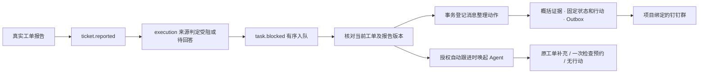

# 自主跟进事件参考

本文说明事件行为。配置按注册来源独立维护，来源可以继续扩展；此处的业务分类只用于阅读，不是框架中的固定枚举。默认配置：[project](../../config/events/project.defaults.json)、[execution](../../config/events/execution.defaults.json)、[clock](../../config/events/clock.defaults.json)。

## task.ready · 依赖解除后的推进判断

默认开启，来源 `project`，类别 `dependencies`。[默认 JSON](../../config/events/project.defaults.json)：

```json
{
  "sources": {
    "project": {
      "on": {
        "task.ready": {
          "enabled": true,
          "description": "项目授权推进且任务依赖已验收，唤起 Agent 判断下一步。"
        }
      }
    }
  }
}
```

事件表示：项目已开工并授权 `autoAdvance`，该任务待办、没有执行工单，前置任务全部验收完成，且没有未回答的任务决策。初次开工、新增可执行任务、开启自动推进以及依赖验收完成，都通过同一个入口检查。空依赖也适用，不要求项目绑定 GitHub。

项目写入与事件入队在同一 SQLite 事务完成。系统仅检查本次变更的项目；日常编排 pass 不再遍历项目并直接派工。启动时一次恢复现有就绪状态。同一就绪轮次只发布一次，处理重复入队或重启不会重复登记工单。

## Agent 决定，服务端约束

事件唤起项目所选 Agent。Agent 读取最新目标、成员、任务、工单和运行能力，选择启动原任务、提醒人工负责人、说明缺项、预约检查或者不行动。服务器不会把事件机械翻译成 `task.start`。默认指导鼓励条件充分时开始执行，具体调用、参数和结果保存到项目 Agent 记录中。

自主跟进仅可检查状态、启动当前事件任务、向原工单补充上下文以及预约/取消检查。它不能创建额外任务、修改目标和分工、批准权限或调用人工验收工具。看板和群里仍共用原有工具和领域校验。暂停项目、关闭自动推进、修改任务范围、撤回依赖或关闭事件后，未落地的旧提案不能继续操作。

## 自定义指导

```json
{
  "sources": {
    "project": {
      "enabled": true,
      "watch": [
        "dependencies"
      ]
    }
  },
  "on": {
    "task.ready": "核对最新验收条件和依赖证据。条件充分时启动当前 Agent 任务；人工任务提醒负责人。如仍缺少实质决定，只问一个具体问题。"
  }
}
```

字符串替换默认 Agent 指导，不能越过权限检查。`false` 停用此事件；`autoAdvance=false` 则关闭该项目的全部自主跟进。关闭后再打开事件不会自动重放 ignored 历史事件。需要重新判断时可通过正常项目消息或已授权的检查预约触发。

## 2048 验收

1. 建立 A「规则与测试清单」和依赖 A 的 B「实现游戏 MVP」，开启项目自动推进。
2. A 交付时，B 仍待办；收到 A 的验收请求。
3. 人工通过 A 的当前交付，不再发送“开始 B”或“更新计划”。
4. 事件记录出现 B 的 `task.ready`，Agent 记录包含该事实及工具结果；条件充分时 B 只登记一次工单。
5. 重启或多次刷新不重复登记。若模型判断条件不足，可以提出具体问题而不派工；这同样是有效决策，不能假装已开工。
6. 判断过程中暂停项目，确认旧提案没有新派工。


## task.blocked · 工单受阻与待回答通知

默认开启，来源 `execution`，类别 `blockers`。[默认 JSON](../../config/events/execution.defaults.json)：

```json
{
  "sources": {
    "execution": {
      "on": {
        "task.blocked": {
          "enabled": true,
          "description": "当前工单报告受阻或等待人工回答，向项目群通知具体原因及问题。"
        }
      }
    }
  }
}
```

设为 `false` 会停用新阻塞事件的群通知，原工单报告和等待状态仍然保存，事件显示 ignored。来源的 enabled 和 watch 也适用；若设置了 execution.watch，需要包含 blockers 才处理本事件。配置方法见[统一配置](README.zh-CN.md)。默认仍先登记阻塞通知。项目 active 且 autoAdvance=true 时，该事实也唤起同一个管理 Agent 判断后续行动；字符串可覆盖默认跟进指导。它不会自动批准权限、修改配置或重新规划。

## 什么会产生事件

执行器调用真实 `orchestrator_report` 后，Engine 在同一 SQLite 事务中产生 `ticket.reported` 事实。执行来源检查：报告明确为 blocked，或当前报告保留了待人工回答的问题，才产生 `task.blocked`。普通进度不主动发群消息，ready 仍由 `delivery.ready` 处理。failed 且没有人工问题的报告不在本事件范围，应在工单状态中查看失败详情。

实例携带项目、任务、工单、当前 Assignment、报告时间、问题引用（如有）、交付版本和通知标识。消费前再核对任务仍进行中、仍关联该工单、版本和报告仍为当前、工单没有结束。旧报告、被替换或已回答的问题、取消和新执行都不能触发过期提醒。



## 通知去哪里

目标从数据库内的项目群绑定读取，与派工从网页、本地请求还是聊天发起无关。消息包含任务、工单、未完成交付的说明、实际原因和待处理问题。使用该任务当前负责人的已绑定钉钉账号进行真实 @；这是当前联络人，不自动授予其部署或权限管理能力。

没有负责人时请群成员明确由谁跟进；没有群绑定时保留事件和工单证据，不向默认群猜测发送。此事件不改变任务为待验收或已完成，也不产生新工单。

本地 request 通道已有的执行回复仍留作原始记录；新事件会独立登记项目群通知，只有钉钉 Outbox 回执为 sent 才表示发送接口已接受。客户端展示及真实 @ 仍需在群里核验。

## 去重、过期和恢复

同一工单、Assignment 和报告版本的重复观察复用事件。多份报告保留同一待答问题时，复用该问题的群通知；没有问题字段的相同阻塞原因，在连续受阻期间也只通知一次。问题变化，或工作已恢复后重新受阻，开启新一轮提醒。

消息整理动作与事件应用同一事务提交；耗时整理在 Effects 执行，完成后事务登记 Outbox。完整报告保留在工单，群里仅发送简短结论、真实卡点和详情入口。源报告、事件与当前阻塞轮次也同一事务保存。投递走既有 Outbox 和重试机制。问题被清除或替换、工单停止后，尚未发送的旧通知撤回；正在发送中的请求无法撤销，实际回执仍保留用于核验。

服务启动时只补查当前项目关联工单的持久报告。旧版本已经受阻却只回复到本地的工单，也经同一个生产入口补入队。重启保留通知标识与回执，避免反复提醒同一问题。停用期间的 ignored 事件不会因打开开关自动重放；新报告产生的新事件按新设置处理。

## 如何验收

1. 让 Agent 的真实工单报告一个实际卡点，附具体待人处理的问题。
2. 检查任务仍进行中，单条工单显示待回答或受阻；群里收到具体问题并 @ 当前负责人。
3. 重复同一问题的报告或重启服务，不应重复发项目阻塞提醒。
4. 若问题在排队期间已经解决或任务已取消，不应再发过期提醒。
5. 处理外部条件后，在原任务中补充信息继续原工单，不用新建任务冒充恢复。部署沙箱在服务启动时确定，群里回复“可以”不能直接更改它。

查询使用现有项目详情、Agent 执行记录和 `GET /orchestrator/api/projects/events?projectId=...`；事件 type 为 task.blocked，data.noticeId 可与本机 Outbox 回执关联。详见[验证记录](acceptance.zh-CN.md)。

## 自主跟进与同一问题去重

自动跟进使用本轮阻塞通知标识作为反应身份；同一待答问题即使多次报告，也只唤起一轮管理 Agent。Agent 可使用已知上下文回答原工单、预约一次检查，或在等待人工且没有新行动时保持安静。不得假装已获得原生审批，不能创建替代任务绕过卡点。原问题解除后再次出现的新阻塞轮次可重新触发。

例如字符串配置为：

```json
{
  "sources": {
    "execution": {
      "on": {
        "task.blocked": {
          "enabled": true,
          "description": "当前工单报告受阻或等待人工回答，向项目群通知具体原因及问题。",
          "instruction": "先核对当前工单与实际执行能力。已有信息能够解决时补充给原工单；需要本机管理者处理时说明具体缺项，不反复请求群内审批。没有新行动时不重复通知。"
        }
      }
    }
  }
}
```


## check.due · 预约检查到达

默认开启，来源 `clock`，类别 `checks`。[默认 JSON](../../config/events/clock.defaults.json)：

```json
{
  "sources": {
    "clock": {
      "on": {
        "check.due": {
          "enabled": true,
          "description": "一次已保存的检查时间到达，唤起 Agent 核对当前任务。"
        }
      }
    }
  }
}
```

这是一次性预约的时间事实，不是固定间隔调用 AI 的扫描器。所选 Agent 可在群聊处理或自主跟进中调用 `follow_up.schedule`，参数为任务 ID、ISO UTC 时间 `at` 和自然语言 `reason`。`follow_up.cancel` 取消该任务预约。可以直接对机器人说明“半小时后看一下这项任务，如果还卡着再提醒”，由 Agent 理解并调用工具，无固定口令。

## 保存与唤醒

- 预约保存到现有 SQLite 的 `project-check:` KV，包含项目、任务、检查时间、原因和当时任务范围/工单版本。
- 每个任务最多一个当前预约；新预约替换旧预约，避免重复催促。允许预约范围是当前时间后 1 分钟至 30 天。
- 进程仅等待最近预约的计时器，到点后在事务中写入 `check.due`，由有序事件队列唤起 Agent；未到点不会调用模型。底层定时器最长等待值有分段保护。
- 到期标识与事件一起提交。服务重启后恢复未来预约，并补入队已过期预约，不需要重新发送群消息。
- 项目暂停、关闭自动推进、任务完成/取消、执行工单或交付范围变化会撤销旧预约。已入队或思考中的旧检查也在操作前重新核验当前预约 ID 和任务版本。
- 读取 `GET /orchestrator/api/projects/:id/checks` 或调用 `project.inspect` 的结果中的 `scheduledChecks`，可核对预约及 `fired` 标记；事件记录含 `checkId`、reason，Agent 记录保存实际工具结果。

Agent 需要新检查时必须明确预约下一次；系统不会自动无限续期。默认指导要求没有新信息且无需行动时安静，不会每次检查都向群里发一段报告。

## 自定义指导

```json
{
  "sources": {
    "clock": {
      "enabled": true,
      "watch": [
        "checks"
      ]
    }
  },
  "on": {
    "check.due": "先核对实际报告和上次跟进结果。只有出现新的阻塞、交付或需要负责人行动时才通知。能够用已有信息解决的卡点，补充到原工单。没有变化时保持安静。"
  }
}
```

`false` 关闭到期反应，仍保留 ignored 事件。项目必须 active 且 `autoAdvance=true` 才允许预约和自主行动。配置保存方法见[统一配置](README.zh-CN.md)。

## 验收

1. 在已开工且允许自动推进的任务上，让机器人预约稍后的检查；确认实际调用 `follow_up.schedule`，工具结果保存了时间和原因。
2. 到时不 @ 机器人，事件记录出现一次 `check.due`，随后出现系统触发的 Agent 记录。
3. 没有新证据时允许无消息；有行动时必须能追溯工具调用及原工单，不能编造完成或新增替代工单。
4. 替换/取消预约、变更任务范围或暂停项目，旧预约不得执行；重启后预约不会丢失或重复执行。
