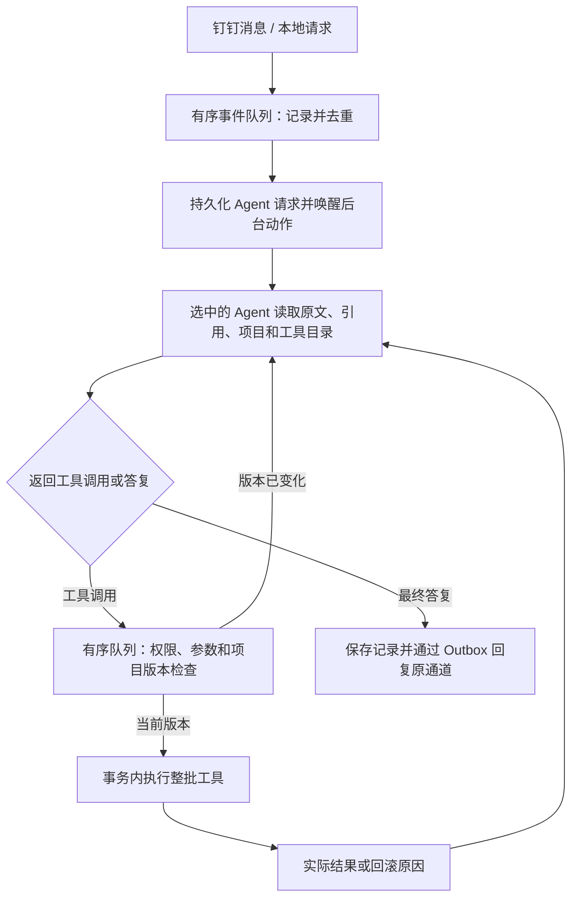

# 项目消息驱动 Agent

事件名为 `project.message.received`，类别为 `messages`，默认开启。已绑定项目群中发给机器人的消息，以及本地管理接口提交的消息，都携带原文、引用、发送人和项目标识进入同一入口。无需用特定词语触发更新计划。首次会议建立项目的入口目前仍由已有会议规划模块处理。

## 默认配置

[默认 JSON](../../config/events/project-message.defaults.json) 提供内置指导。使用空配置即可采用默认值，也可以只填写：

```json
{
  "on": {
    "project.message.received": true
  }
}
```

用自然语言字符串覆盖指导，适用于调整回复和协作方式：

```json
{
  "on": {
    "project.message.received": "结合引用和现有分工处理请求。回复说明实际变化，以及下一步由谁行动。"
  }
}
```

设为 `false` 关闭处理；关闭后新事件记录为忽略，处理中的请求在提交操作前也会检查开关。已提交的操作保留。来源开关和 `watch` 类别选择沿用[统一配置](README.zh-CN.md)。配置接口提交整份配置及当前修订号，请保留仍然需要的其他选项。

## 如何处理



Agent 通过工具完成具体操作，调用目录见[项目工具说明](project-tools.zh-CN.md)。没有预设的意图枚举或关键词分流。创建任务、指派成员与启动执行是独立能力；Agent 根据请求和已有分工组合工具。单纯整理条件和分工无需启动执行。

有序队列只承担持久化和短事务，不等待模型或远端网络。模型调用由现有 `Effects` 唤醒执行；空闲时没有常驻思考的 Agent。模型返回的操作也作为事件入队。它思考期间若项目已变化，旧操作丢弃，再基于新快照判断，连续冲突三次后明确告知用户。每次请求最多六轮工具调用；每轮模型故障最多尝试两次，仍失败会回复原因。

同一来源、同一消息 ID 的重复投递只建立一个处理记录。工具批次内任何一步失败，整个批次的数据库变更和待执行动作一起回滚，失败原因返回 Agent。已经执行的批次不会因重复投递重做。重启恢复未完成动作；已保存的模型决定直接恢复入队。远端 Issue 创建使用原有幂等和丢失响应恢复机制。

服务端在思考前和提交前检查项目成员及群绑定；工具再次检查权限和任务所属项目。模型不能自行绕过依赖检查、执行条件或给其他项目派工。人工验收已通过 `review.decide` 接入同一工具循环，见[验收通过](review-accepted.zh-CN.md)及[退回](review-rejected.zh-CN.md)。消息中的验收短引用从真实历史记录解析并绑定，重新判断不能擅自改为新版。自主跟进事件共用这套 Agent 工具循环，系统事实与成员消息分别记录，见[自主跟进](autonomous-follow-up.zh-CN.md)。

## 查询与验收

请求头使用 `X-Orchestrator-Request: 1`，写入接口使用 JSON：

| 接口 | 用途 |
| --- | --- |
| `POST /orchestrator/api/projects/:id/messages` | `{"messageId":"客户端唯一标识","text":"这项先补充验收条件","quoted":"所引用的任务说明"}`，返回请求 ID 和 queued/disabled |
| `GET /orchestrator/api/projects/:id/agent-runs` | 最近 20 次请求的原文、工具调用、实际结果、冲突次数、最终回复和状态 |
| `GET /orchestrator/api/projects/tools` | 当前可执行工具的名称、说明、参数 JSON Schema |
| `GET /orchestrator/api/projects/events?projectId=:id` | 消息及工具决定的处理时间线 |

本地管理接口代表本机管理者，不能提交 `actorId` 冒充群成员。钉钉来源使用真实发送人绑定，引用来自原生回复上下文。请求记录可能含内部讨论和成员标识，沿用项目数据库的访问控制。

回归场景：引用待明确的测试任务，提出“请你帮忙梳理验收通过条件并分派给李顺阳”。应看到实际任务创建或更新、具体条件和成员分工；在没有要求执行时，不产生工单。再明确要求开工时，才调用开工及执行工具。自动测试模拟模型决定以验证队列和工具行为，真实模型验证需另行记录结果。
