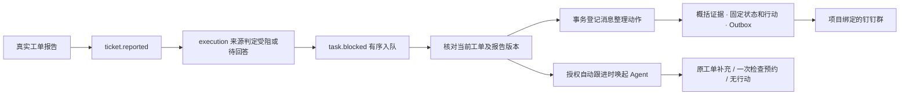

# task.blocked · 工单受阻与待回答通知

默认开启，来源 `execution`，类别 `blockers`。[默认 JSON](../../config/events/task-blocked.defaults.json)：

```json
{
  "on": {
    "task.blocked": true
  }
}
```

设为 `false` 会停用新阻塞事件的群通知，原工单报告和等待状态仍然保存，事件显示 ignored。来源的 enabled 和 watch 也适用；若设置了 execution.watch，需要包含 blockers 才处理本事件。配置方法见[统一配置](README.zh-CN.md)。默认仍先登记阻塞通知。项目 active 且 autoAdvance=true 时，该事实也唤起同一个管理 Agent 判断后续行动；字符串可覆盖默认跟进指导。它不会自动批准权限、修改配置或重新规划。

## 什么会产生事件

执行器调用真实 `orchestrator_report` 后，Engine 在同一 SQLite 事务中产生 `ticket.reported` 事实。执行来源检查：报告明确为 blocked，或当前报告保留了待人工回答的问题，才产生 `task.blocked`。普通进度不主动发群消息，ready 仍由 `delivery.ready` 处理。failed 且没有人工问题的报告不在本事件范围，后续另接失败事件。

实例携带项目、任务、工单、当前 Assignment、报告时间、问题引用（如有）、交付版本和通知标识。消费前再核对任务仍进行中、仍关联该工单、版本和报告仍为当前、工单没有结束。旧报告、被替换或已回答的问题、取消和新执行都不能触发过期提醒。



## 通知去哪里

目标从数据库内的项目群绑定读取，与派工从网页、本地请求还是聊天发起无关。消息包含任务、工单、未完成交付的说明、实际原因和待处理问题。使用该任务当前负责人的已绑定钉钉账号进行真实 @；这是当前联络人，不自动授予其部署或权限管理能力。

没有负责人时请群成员明确由谁跟进；没有群绑定时保留事件和工单证据，不向默认群猜测发送。此事件不改变任务为待验收或已完成，也不产生新工单。

本地 request 通道已有的执行回复仍留作原始记录；新事件会独立登记项目群通知，只有钉钉 Outbox 回执为 sent 才表示发送接口已接受。客户端展示及真实 @ 仍需在群里核验。

## 去重、过期和恢复

同一工单、Assignment 和报告版本的重复观察复用事件。多份报告保留同一待答问题时，复用该问题的群通知；没有问题字段的相同阻塞原因，在连续受阻期间也只通知一次。问题变化，或工作已恢复后重新受阻，开启新一轮提醒。

消息整理动作与事件应用同一事务提交；耗时整理在 Effects 执行，完成后事务登记 Outbox。完整报告保留在工单，群里仅发送简短结论、真实卡点和详情入口。源报告、事件与当前阻塞轮次也同一事务保存。投递走既有 Outbox 和重试机制。问题被清除或替换、工单停止后，尚未发送的旧通知撤回；正在发送中的请求无法撤销，实际回执仍保留用于核验。

服务启动时只补查当前项目关联工单的持久报告。旧版本已经受阻却只回复到本地的工单，也经同一个生产入口补入队。重启保留通知标识与回执，避免反复提醒同一问题。停用期间的 ignored 事件不会因打开开关自动重放；新报告产生的新事件按新设置处理。

## 如何验收

1. 让 Agent 的真实工单报告一个实际卡点，附具体待人处理的问题。
2. 检查任务仍进行中，单条工单显示待回答或受阻；群里收到具体问题并 @ 当前负责人。
3. 重复同一问题的报告或重启服务，不应重复发项目阻塞提醒。
4. 若问题在排队期间已经解决或任务已取消，不应再发过期提醒。
5. 处理外部条件后，在原任务中补充信息继续原工单，不用新建任务冒充恢复。部署沙箱在服务启动时确定，群里回复“可以”不能直接更改它。

查询使用现有项目详情、Agent 执行记录和 `GET /orchestrator/api/projects/events?projectId=...`；事件 type 为 task.blocked，data.noticeId 可与本机 Outbox 回执关联。详见[逐步验收记录](acceptance.zh-CN.md)。

## 自主跟进与同一问题去重

自动跟进使用本轮阻塞通知标识作为反应身份；同一待答问题即使多次报告，也只唤起一轮管理 Agent。Agent 可使用已知上下文回答原工单、预约一次检查，或在等待人工且没有新行动时保持安静。不得假装已获得原生审批，不能创建替代任务绕过卡点。原问题解除后再次出现的新阻塞轮次可重新触发。

例如字符串配置为：

```json
{"on":{"task.blocked":"先核对当前工单与实际执行能力。已有信息能够解决时补充给原工单；需要本机管理者处理时说明具体缺项，不反复请求群内审批。没有新行动时不重复通知。"}}
```
