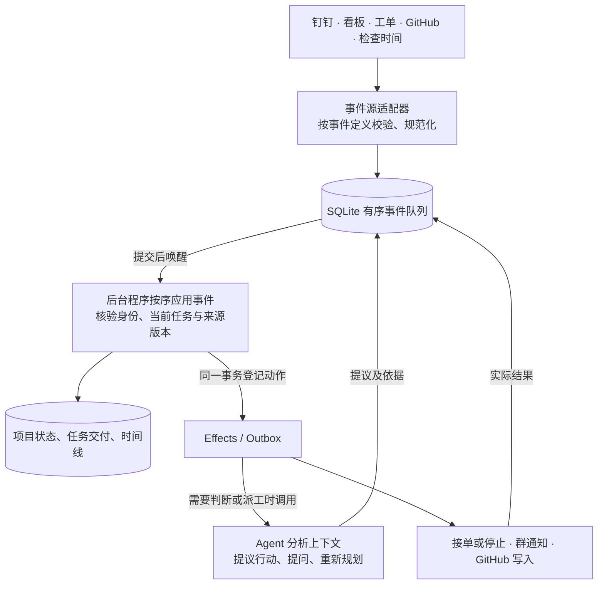
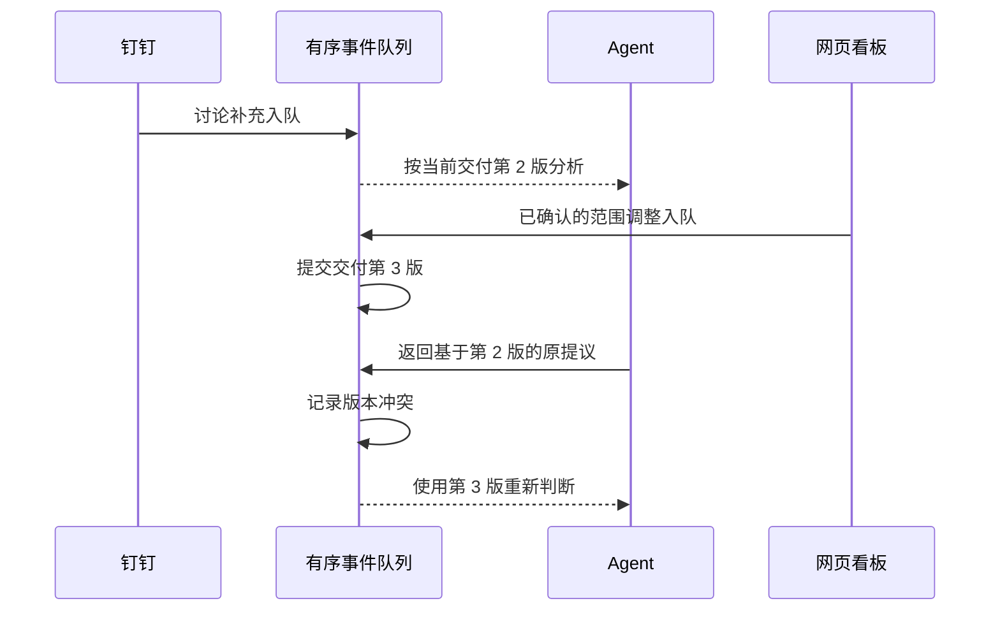

# SuperAgent 项目推进 Proposal

**评审稿 · 基于有序事件队列**

项目怎么推进，由当前发生的事决定。会议纪要、群里的一句话、看板操作、Agent 交付、GitHub 合并、到期未更新，都可以进入同一条事件链。每类事件定义三件事：它证明了什么、可以直接触发什么、哪些判断交给 Agent。任务状态用来记录这些事件的结果，团队可以从看板看到当前在等什么。

首版在现有 SuperAgent 的 SQLite 内使用**一条持久化的项目事件队列，按入队序号串行提交状态变化**。看板、钉钉、现有 Engine 和 GitHub 都接到这条队列。模型调用和外部操作由现有的 `Effects`、`Outbox` 执行，结果再次入队。项目仍使用一个选定的 Agent，仓库绑定保持可选。 [持久化动作队列](../src/app/effects.ts) · [消息投递](../src/app/outbox.ts) · [SuperAgent Engine 事件](../src/core/ports.ts)

## 1. 一个事件怎样驱动项目



队列处理的是事实和操作请求。收到纪要只能证明收到了一条消息。Agent 可以结合讨论和看板提出目标、分工和任务变更。项目成员明确同意的内容、有权限的操作者和当前项目版本都能核验时，服务端才应用变更。类似地，Agent 报告「已完成」证明提交了交付证据。谁能验收、验收对应哪一轮，要按持久化记录判断。

**系统自动处理可以从事实直接得出的结果。** 例如项目所需的交付证据齐全就生成验收请求，验收通过就解除依赖，已确认由任务负责解决的 Issue 就登记关闭。**Agent 处理需要上下文判断的问题。** 例如从讨论提取行动，从交付受阻判断该向谁提问，或根据延期和依赖建议换执行人、调整范围。Agent 返回结构化提议，带原因、引用的事件和所依据的版本。能否自动执行取决于项目已授权的范围。需要团队决定时，发一条具体问题，回复再形成新事件。

### 后台服务怎样唤醒 Agent

SuperAgent 后台服务接收事件。事件写入 SQLite 并提交后，通过现有的 `Store.afterCommit` 唤醒一个进程内的队列处理器。处理器按序处理待办事件，队列为空时挂起，等待下一次唤醒。服务启动时接着处理已持久化的事件和动作。检查点和重试由后台定时唤醒。使用轮询的外部来源仍由各自的适配器收集事实。 [提交后回调](../src/app/store.ts) · [现有后台动作调度](../src/app/effects.ts)

只有事件处理明确登记了「需要 Agent 判断」或「需要 Agent 执行」的动作，后台调度才调用 Agent。例如，新会议纪要触发一次分析；结果和验收条件都已齐备时，后台可以直接发钉钉验收通知，验收通过后也能自行同步 Issue。Agent 忙碌或暂不可用时，需要它的动作留队，任务显示「等待 Agent」。已经登记的验收通知、Issue 同步和其他就绪事件继续由后台处理。

即使进程在 SQLite 提交之后、发送唤醒信号之前退出，服务重启时也会捞回该事件。后台服务停机期间，处理和交付暂停。服务运行且队列空闲时，Agent 可以保持空闲；下次有需要它的事件再调用。

## 2. 事件目录

### 事件源接口与统一 JSON 配置

用户配置表达要接入哪些来源，以及希望项目怎样推进。平台协议和各事件字段由事件源适配器内置。事件源、定义模板、事件实例和处理器仍保留，用户使用系统提供的默认定义和行为，通过一个 JSON 调整需要的部分。

下面是一份完整的配置示意。键名待实施时确定。

```json
{
  "sources": {
    "github": {
      "enabled": true
    },
    "dingtalk": {
      "enabled": true
    }
  },
  "automation": {
    "startNextTask": false,
    "closeResolvedIssue": true
  },
  "on": {
    "task.blocked": "结合项目进展判断原因，联系能解决问题的人，需要调整分工时提出建议。"
  }
}
```

这份配置表示接入 GitHub 和钉钉，使用各项目已经绑定的仓库与群。后台按内置行为跟进代码变更、交付和验收，已验收任务负责解决的 Issue 自动关闭，后续任务由成员明确开工。发生任务受阻事件时，唤起 Agent 按这里的说明判断下一步。任务状态、人员和仓库群绑定仍从数据库读取，凭据沿用部署的连接设置。

| 用户想调整什么 | JSON 怎样修改 |
| --- | --- |
| 开启或关闭来源 | 设置对应来源的 `enabled`。默认监听范围是数据库中项目绑定的资源 |
| 只关注来源中的几类内容 | 可选增加 `watch`，例如 GitHub 的 `["pull_requests", "issues"]`。选择 pull_requests 后，适配器会处理它的创建、更新、评审、关闭、合并等变化 |
| 调整默认推进 | 在 `automation` 中设置是否自动开始下一个任务、是否关闭任务负责解决的 Issue。省略的字段使用系统默认值 |
| 定制某个事件的 Agent 判断 | 在 `on` 中选一个系统列出的事件，填写自然语言说明。未配置的事件沿用默认行为，例如交付可验收时通知验收人 |

`on` 是对该事件的 Agent 指导说明。相同事件只有一个配置入口，更新内容覆盖原指导。后台确认事实、按序提交状态、检查当前交付和发送已登记通知的行为由程序执行。填写指导的事件到达后，系统关联项目上下文唤起 Agent，并按已有权限执行它提出的动作。

**更换来源的例子。** 以后接入 GitLab 适配器后，配置启用 GitLab，项目绑定迁到对应仓库。GitHub PR 和 GitLab Merge Request 的状态由各自适配器归入共用的代码变更事实，任务受阻、交付可验收、验收通过这些项目事件继续使用相同的 `on` 配置。平台专属功能通过该适配器提供的可选项设置。新增平台的认证和协议映射仍需实现一次适配器，系统随后可以复用它接入多个项目。

开发侧沿用现有 `SourceKind` 和 `SourceRegistry` 扩展事件源能力。适配器声明可供选择的监听类别，携带默认字段校验、事件映射、身份和去重方式。内部事件记录仍保存类型、来源、对象和版本，队列处理器据此防止重复推进和过期操作。用户保存 JSON 时，系统校验来源、开关和事件名并显示具体错误。 [现有事件源接口](../src/sources/kind.ts) · [事件源注册](../src/sources/registry.ts)

### 事件怎样参与项目推进

同一个事件可以触发多项动作，也可能只补充事实。不同项目会因为已有证据、成员分工和授权不同，得到不同结果。

### 讨论和人工操作

| 事件 | 记录什么 | 驱动什么 |
| --- | --- | --- |
| **收到会议纪要或讨论补充** | 发送人、项目、会议来源、消息引用 | 唤起 Agent 提取已议定行动、候选任务和待问问题。行动明确时形成可提交的变更，其余问题可单独追问。补充内容进同一会议记录 |
| **收到任务操作请求** | 操作者、来源、任务或引用、操作意图和所见版本 | 看板可以直接提交结构化请求。群里的自然语言由 Agent 解析为开工、交付、验收、退回、开 Issue、调分工等操作。目标唯一且符合权限时提交，否则只问所缺的一项信息 |
| **收到 Agent 的行动提议** | 触发它的事件、依据版本、目标、原因和拟执行动作 | 校验当前状态和授权。允许时提交对应操作并留下原因。证据变化时重新评估，或提示谁来决定 |
| **项目或任务变更已提交** | 新目标、分工、依赖或交付要求及变更来源 | 新任务进入待办。相关变更唤起受影响任务的就绪检查。改变在途交付范围时，记录交接并为新交付建立版本 |
| **检查时间已到** | 约定的检查时间、任务及当时登记的等待原因 | 先看等待是否已解除。仍然受阻时，Agent 可根据依赖和上下文建议跟进，或提醒能处理的人。同一检查点的重复投递沿用原处理记录 |

### 执行和 GitHub 事实

| 事件 | 记录什么 | 驱动什么 |
| --- | --- | --- |
| **派工已登记／工单已接单** | 任务、交付版本、授权范围、工单身份 | 登记后显示「进行中 · 排队」。接单后展示真实工单状态，并带入会议决定、验收标准和已完成依赖的证据 |
| **工单报告已提交／人工交付已提交** | 当前交付的产物、证据、结果或阻塞问题 | 普通进展写入时间线。材料齐全时检查是否可验收。需要人提供信息时，Agent 可拟一条具体问题。只有属于当前交付的报告参与判断 |
| **工单已停止或执行失败** | 工单、原因和最后一份有效进展 | 显示等待处理或可重试；必要时让 Agent 推荐续跑、改派或缩小范围。已有交付证据保留 |
| **PR 状态已确认** | 仓库、PR、目标分支、观察到的代码版本和远端状态 | 已关联 PR 合并时补齐代码交付证据。关闭未合并时显示卡点，可请求补改或换 PR。技术评审意见按 SuperAgent 现有规则送回工单 |
| **Issue 状态已确认／外部动作已返回** | 远端结果、动作 ID、失败原因或投递回执 | 更新时间线和同步状态。可恢复失败按同一动作重试，权限不足或结果未知时给出处理入口 |

### 交付和推进结果

| 事件 | 记录什么 | 驱动什么 |
| --- | --- | --- |
| **交付已可验收** | 当前证据版本、验收请求、受指派的人 | 看板进入待验收；已绑定群时主动 `@` 验收人，附结果、标准和引用。缺验收人时明确显示并请项目负责人指定 |
| **验收已通过** | 验收人、交付和验收请求的版本、确认依据 | 完成任务，登记下游检查。若任务负责解决关联 Issue，同时登记关闭动作 |
| **交付已退回** | 退回原因、原验收请求和新一轮交付 | 旧请求失效，任务回进行中。已有授权覆盖返工时可继续，范围或人员需要调整时请相关负责人决定 |
| **依赖已满足** | 哪些验收结果使下游可以开工 | 人工任务显示可以开始并可通知执行人。自动派发打开、执行范围已授权且运行条件满足时登记 Agent 派工 |
| **任务已取消或重开** | 操作者、原因、受影响的当前交付和依赖 | 取消作废待验收请求并停止当前执行。重开保留以往交付和验收，重新检查依赖；已有下游开工时先明确如何处理该依赖 |

## 3. 队列怎样处理矛盾

**入队顺序由 SQLite 在提交时分配。** 每条记录保存 `seq`、事件 ID、来源、来源版本、操作者、目标，以及引发它的事件或操作。`seq` 决定本系统的处理顺序，平台时间戳用于追溯。事务提交后的入队顺序就是项目状态的提交顺序。首版一条队列覆盖所有项目，优先把并发行为做清楚。

1. **取最早的待处理事件。** 在同一事务中读取最新项目和任务，检查权限、当前交付、来源版本和该操作要求的前置条件，写入新状态、事件处理结果与待执行动作。其他入口通过队列提交写操作。Engine 的派工和报告等已落库事实，在其来源事务内登记事件，覆盖「工单已写入、事件还未入队」时的崩溃窗口。
2. **提交后执行耗时动作。** Agent 推理、GitHub 请求和钉钉投递在事务外执行。队列可以继续消费后面的事件。等待模型判断的消息有自己的处理状态，回复可以说明「正在判断这条请求」。每个返回的提议或远端结果获得自己的入队序号，并关联原事件。
3. **处理迟到和冲突。** 指定了上一轮交付的回复或 Agent 提议只能作用于对应版本。仍有效的提交使用当前状态；已失效的操作记录明确结果，例如「引用的是上一版，请查看当前交付」。先收到的消息如果还在等模型解析，其提议按返回后入队的顺序处理，并校验此前看到的上下文。
4. **重复与恢复。** 看板重试使用原请求 ID，钉钉使用群与消息 ID，工单回报使用工单、Assignment 和报告版本。GitHub webhook 或轮询对同一次变化去重。来源版本不足以判断先后时，补读远端当前状态后再更新，保留后续真实重开的变化。启动时从待处理事件和未完成动作恢复。无效请求记录原因后继续，数据库故障使消费暂停并保留待处理序号。

| 冲突 | 按序处理的结果 |
| --- | --- |
| 看板通过验收与钉钉退回几乎同时到达 | 两条操作引用同一个验收请求。先提交的有效操作决定该轮，第二条看到请求已结案，回当前结果。验收通过只会登记一次关 Issue 和下游检查 |
| 刚调整验收范围，Agent 的旧计划才返回 | 提议携带旧交付或旧计划版本。队列保留提议及其依据，按当前任务重新判断，过期提议不能派工 |
| GitHub 先报告合并，Agent 后提交证据 | 两个事件分别记录事实。后到的事实使当前交付达到验收条件时创建请求。反过来也是同一个判断 |
| Issue 关闭待发送时任务重开 | 发送前重新核验任务状态、交付版本和 Issue 关联。已失效的动作作废。请求已发出时核对远端结果，在看板显示状态差异 |
| GitHub 或钉钉超时 | 动作保留稳定 ID，优先查远端状态或投递回执。不能确认钉钉是否已收到时显示「投递结果待确认」，支持人工核对后补发。其他项目的状态事件继续处理 |



## 4. 用同一组事件处理任务、PR 和 Issue

任务保存目标、预期交付、验收条件、执行人、验收人和依赖。看板用「待办、进行中、待验收、已完成、已取消」展示当前结果。进行中可显示排队、等输入、待合并等原因。更改优先级或截止日期只更新任务修订；更改交付范围、目标分支或验收标准时开新交付版本。验收绑定当前证据版本和请求 ID。

- **任务可在无仓库时交付。** 纪要、调研、实验等靠实际产物和当前交付证据进入待验收。任务如果声明通过 PR 交付，开工时核对项目仓库与目标分支，验收前核对有效交付报告和已合并的代码版本。PR 可以在结果前或后到达。变更继续走 GitHub 技术评审，默认由具备权限的人合并。
- **Issue 是可选关联。** 从任务创建的 Issue 默认由任务负责解决，已有 Issue 可以指定「负责解决」或「仅参考」。一个 Issue 只能有一个任务负责关闭，其他任务可引用。任务验收通过触发关闭为 `completed`。权限或同步问题显示在时间线，依赖根据任务验收结果解锁。GitHub 上关闭、重开 Issue 只更新其远端状态。 [GitHub Issue 更新接口](https://docs.github.com/en/rest/issues/issues#update-an-issue)
- **PR 只引用需要等项目验收后关闭的 Issue。** 系统创建的 PR 用 `Refs #123` 等普通引用。GitHub 支持用 `Fixes` 或 `Closes` 等关系在合并时自动关闭 Issue，所以已有外部 PR 的提前关闭要记录远端事实及其与任务验收的差异。 [GitHub 的 PR 与 Issue 关联规则](https://docs.github.com/en/issues/tracking-your-work-with-issues/using-issues/linking-a-pull-request-to-an-issue)
- **自动派发是一个动作授权。** 关闭时，任务交付、群内提醒、验收、Issue 同步和依赖更新照常处理。开关打开也要满足项目已开工、依赖已通过、任务获准由 Agent 执行、范围明确等条件。项目暂停期间仍记录在途工作事实，新派工等待恢复。

## 5. 用户看到什么

看板和钉钉共用同一个操作入口及结果模型。看板任务详情显示交付、当前在等谁、下一步和时间线。群内通知带任务及当前交付引用。成员可以引用消息并说「这项交给 Agent」「帮我给这项开个 Issue」「这个版本可以了」「补上触屏操作再提交」。需要选择时给出具体任务或交付，短语本身不决定动作。

群里说「已派工」表示工单已登记，「Issue 正在同步」表示关闭动作已经入队，「已关闭」需要 GitHub 回执。普通进展保留在任务里。主动发到群里的消息聚焦待验收、需要决策、任务解锁等可行动变化。已有钉钉组织账号与项目成员绑定用于识别身份和实际 `@`；没有绑定时，看板保留对应的验收和待通知状态。

项目负责人有权调整任务和指定验收人，指定成员对当前任务交付做验收。项目可以显式授权本地操作员代验收，记录操作者和理由。Agent 根据讨论提出改派或调整范围，根据授权决定是否自动提交。已开工任务换人或改变授权范围时，事件里保留旧工单、已做工作和交接决定。

## 6. 模块与落地边界

| 模块 | 负责什么 | 接入现有系统 |
| --- | --- | --- |
| 事件源适配 | 记录看板操作、钉钉消息、会议材料、工单和仓库事实。规范化来源、身份和对象 | 扩展 `SourceKind` 与 `SourceRegistry`，接入项目 API、`ProjectActions`、`ProjectPlanning`、Engine 事件和 GitHub 监听 |
| 统一 JSON 配置 | 配置来源、监听类别、自动推进选项和事件指导 | 适配器内置事件结构和映射，保存时校验配置，省略的配置使用系统默认行为 |
| 项目事件队列 | 持久化、排序、去重、记录消费结果，重启后恢复 | 同一 SQLite 增加项目事件记录。现有 `Effects` 同种动作可排队，它按类型调度；跨来源状态变更统一走项目队列 |
| 项目事件处理 | 对照最新状态应用一条事件，记录检查结果、更新读模型并登记后续动作 | 复用 `Projects` 的实体及依赖数据。逐步接管现有 `advanceProjects` 的状态推进，周期补查也把观察事实提交到队列 |
| Agent 判断 | 结合触发事件、相关任务、讨论、工单和当前权限，提议下一步或追问 | 继续使用已选定的 Agent 及其工单执行适配。结构化提议带引用和所见版本 |
| 动作执行 | 派工、问人、发通知、开或关 Issue，回写结果 | 复用 Engine、`Effects`、`Outbox` 和 `ProjectIssues`。同一验收请求、交付或 Issue 操作用稳定键关联 |
| 看板与时间线 | 显示当前状态、事实来源、动作结果及下一步，供网页和群内查询 | 保留项目看板和 Agent 状态页，项目通知由新事件处理统一产生 |

每个任务继续使用稳定 ID。存量工单和可确认的 PR 关联导入对应交付；历史已完成任务保留结果。已有 Issue 默认迁移为「仅参考」，由成员明确哪项可以在验收后关闭。迁移时使用历史通知回执核对，切换后的项目只由新队列推进。 [当前项目推进](../src/app/project-progress.ts) · [看板 API](../src/app/http.ts) · [GitHub PR 监听](../src/sources/github-pull.ts)

## 7. 验收这套设计

用同一组事件做不同顺序和权限的测试。第一批验证单队列、任务版本与普通交付，并用看板和钉钉两条入口交叉操作。再接 PR 和 Issue 事实，最后用 SQLite 副本演练存量迁移。

| 验收用例 | 通过条件 |
| --- | --- |
| 会议没有完整方案，已有清楚的分工 | Agent 能登记已确定的可执行任务。未决项保留为问题，之后有消息才继续处理 |
| 同一份讨论发生在不同项目状态下 | 新项目产生新任务，在途项目产生调整提议。提议引用各自项目的事实和版本 |
| 人工交付与 Agent 交付 | 共用验收事件。自动派发关闭时照常主动提醒，验收后下游可开工 |
| 队列空闲或 Agent 不可用 | 队列空闲时没有模型调用。入队事件按需唤醒 Agent；Agent 不可用时，已登记的验收提醒和 GitHub 同步仍由后台处理 |
| 看板通过与群里退回同时进入 | 验收只有一个有效结果。另一个请求可查到冲突原因。下游检查、提醒和外部动作不会重复登记 |
| PR 和报告两种到达顺序 | 同一个有效交付版本只创建一次验收请求。旧 PR、旧报告或旧群消息不会推进新版本 |
| 提交事件后、唤醒前重启，或重启时有远端写入 | 启动时恢复已提交事件和未完成动作。结果不确定的远端请求先核对并反映在时间线 |
| 两个仓库各有一个 PR #1 | 两条事实以仓库及对象标识各自路由，触发正确项目的状态更新 |
| 两种 GitHub 输入报告同一个 PR 状态 | webhook 和轮询通过同一个事件定义进入队列，同一次合并只推进一次。后续不同的合法状态变化可以再次生效 |
| 默认配置与来源切换 | 只开启来源即可使用内置监听和项目推进。省略可选配置时使用默认值。新适配器产生同一项目事件时可复用原有事件指导。无效配置返回具体原因 |
| 已部署项目迁移 | 现有任务和在途工单仍能回写，历史完成或提醒记录不会触发批量补发或关闭 Issue |
