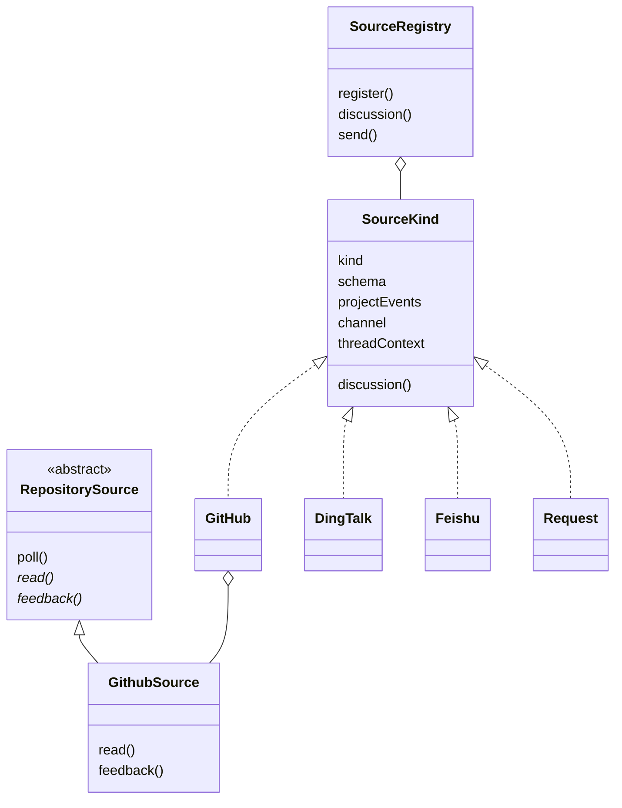
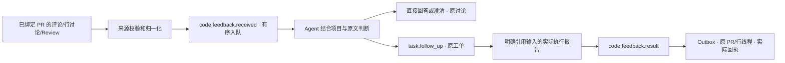

# 事件源结构与扩展

事件源按提供者收敛为一个文件：GitHub、钉钉、飞书、本地请求分别位于 `src/sources/github.ts`、`dingtalk.ts`、`feishu.ts`、`request.ts`。每个文件包含该来源的配置、协议数据校验、归一化、上下文读取、运输和回写能力；只有公共契约与可复用机制放在共享文件。

Node.js / TypeScript 支持类、抽象类和接口。此设计把所有来源的共同边界表达为 `SourceKind` 接口；真正共享执行步骤的仓库来源使用 `RepositorySource` 抽象基类，GitHub 继承它。Stream、CLI 消费和本地 HTTP 请求保留各自生命周期，不创建没有共同工作的空基类。

`SourceKind` 的结构类型检查确保各提供者遵循同一契约。`SourceRegistry` 只按注册能力分派，业务工具通过 `discussion()` 获取回复地址，不识别提供者名。每个提供者可以有自己的协议字段、认证、分页及运输，调用者不负责重建平台 URL 或线程地址。

## 共同机制由谁负责

| 层 | 职责 |
| --- | --- |
| 来源文件 | 接入、来源配置、远端身份、API/回调校验、协议归一化、原始讨论地址及幂等回写 |
| `RepositorySource` | 按提供者筛选资源、关联资源读请求复用、按任务/版本保存游标、重叠读取、失败隔离、持久事实发布；适配器实现 accepts/read/feedback 三个协议方法 |
| `ProjectEvents` | 来源和类型注册、按来源生成带描述默认 JSON、配置继承、序号队列、去重、事务及恢复 |
| 项目事件模块 | 当前绑定、权限、版本和反应授权；注册该反应允许的工具及 current 检查 |
| `ProjectAgent` | 一套模型/工具循环，根据上下文决定回答、澄清或跟进；不维护提供者分支或固定事件工具表 |
| 原工单和 `Outbox` | 执行实际工作，明确回答哪条输入；原讨论结果经事件登记、可靠投递并保留回执 |

内部的 project、clock、execution、review 等模块发布业务事实，也使用 ProjectEvents 的注册与配置契约。它们属于任务业务与时钟，不混进某个外部平台的运输实现。飞书原有事件消费、历史恢复、图片读取与回复仍走共同 SourceRegistry/Engine；本轮不新增未配置的飞书项目群绑定。

## PR 协作采用同一事件模型

PR 技术评审不是任务业务验收。反馈反应不能更改目标、另派工单、合并、关闭 Issue 或自行验收。普通 PR 评论不提供 commit 时不虚构版本；行评审/Review 保留原生 commit，不能用旧提交反馈直接修改新交付。代码合并或版本失效按真实事实处理，验收负责人仍通过原有验收入口确认。

跨渠道展示保留 `originalChannel`；旧记录通过注册的来源能力恢复可验证的原地址。自动回声同时匹配账号、持久输出回执和精确消息内容；不会因为人与自动化共用一个登录账号而全部过滤。评论事实保留 GitHub 作者身份，不冒充已绑定的钉钉成员。

## 新增来源

1. 新建一个来源文件，导出实现 `SourceKind` 的描述，声明事件定义及协议数据 schema。定义中包含 description、默认反应和说明文档。
2. 有仓库观察能力时继承 RepositorySource，在该文件中实现 accepts/read/feedback；accepts 只接收该平台的关联资源。有讨论回复能力时实现 discussion 和 channel.send。
3. 在宿主安装来源。事件目录、来源配置模板和有效值通过现有注册机制自动出现；维护该来源的一份 JSON。
4. 为新增业务事件安装同步处理器；若需要 Agent 决策，注册该事件的工具白名单与当前授权检查，不修改 Agent 的公共循环。

真实提供者的认证和协议仍需实现；单独写 GitLab JSON 不会安装 GitLab SDK。测试中的第二个提供者用于验证模板机制没有写死 GitHub；它不表示本机已经连接真实 GitLab。

配置入口见[事件配置](events/README.zh-CN.md)，PR 人工验收见[2048 清单](2048-manual-acceptance.zh-CN.md)。
