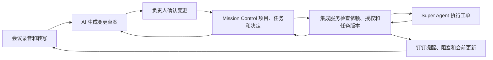

# 基于 Super Agent 和 Mission Control 的团队项目推进提案

建议先在一个方向仍有不确定性的真实项目上试行两周。每轮同步会产生一份可确认的项目变更，会间由 AI 推进已授权的工作、收集证据并处理阻塞。团队在下一轮同步会上根据证据决定继续、转向、暂停或组建新的任务小组。

**Mission Control 记项目承诺，Super Agent 执行已授权工作，钉钉承载团队沟通。** 两边之间加一个小型集成服务，负责把会议变更落账、把合格任务派发出去，并把执行结果对回原任务。先用人工转写导出和人工确认跑通闭环，再自动化可靠且重复的部分。

## 一、团队的工作方式

项目从一页可随证据修订的问题陈述开始。第一次会议只需确定当前问题、已知约束、一个项目负责人和下一次判断的时间。即使方向尚未成形，也可以约定一个低成本、能缩小不确定性的动作，例如拿一个真实样本做实验、访谈两位使用者，或测出现有流程的基线。目标稳定后，可在 Mission Control 中沉淀为业务目标和里程碑。

| 节点 | 人的动作 | AI 的动作 |
| --- | --- | --- |
| 会前 | 阅读变化，补充关键事实 | 汇总上轮判断、证据、老化阻塞和本轮要回答的问题 |
| 会中 | 讨论选择，明确哪些是猜想、哪些已同意，确认谁接手以及何时回看 | 保存讨论证据，保留说话人和时间戳，提取尚待确认的歧义 |
| 会后 | 项目负责人确认一组变更，相关负责人确认接手或给出替代安排 | 对照最新项目状态起草变更，列出新增、继续、调整、暂停、替换及受影响的依赖 |
| 会间 | 提交证据、做取舍、验收交付 | 派发合格的 Agent 任务，跟踪人类任务承诺，检查依赖和交付物，合并提醒并升级真阻塞 |
| 下一轮同步 | 用新证据决定方向和人员安排 | 显示上轮承诺与实际结果的差异，指出旧工作里仍值得保留的成果 |

把会中讨论归为四种可操作的记录：观察到的事实、待验证的假设、已确认的决定、待决问题。每条准备执行的任务需要一个预期产物、一位负责验收的人和下一次检查时间。实验证伪假设也可以算任务完成，并为方向调整提供依据。暂时没有团队共识的方向进入待决事项，可以同时保留几条假设。

### 一次转向如何发生

以「改善 Agent 跑完任务后干等人工」为例。第一轮会议只形成一个假设：等待主要来自审批。确认的动作是让 Agent 统计近期样本，让一名同事抽查归因，约定下次会议用等待时长分布决定是否改审批流程。

样本显示最大等待来自上游数据交付。第二轮会上，项目负责人确认方向由「缩短审批」转为「减少数据准备等待」，暂停尚未开始的审批原型，保留归因样本和脚本。数据同事接手一个交付契约实验，原负责人把脚本和已知限制交给新小组。AI 更新依赖和下次检查点，停掉失去授权范围的在途工单，继续追踪数据实验并在下次会前带回证据。前后两轮的判断和归因都有记录。

## 二、两个仓库的能力和缺口

| 能力 | 实际实现 | 对试点的含义 |
| --- | --- | --- |
| Super Agent 接单与执行 | 钉钉群内可用 `@机器人 #任务ID` 延续工单。现有 Policy、Mandate 和 Ticket 管准入及范围，Codex Worker 在该 Ticket 的独立 Git worktree 中执行。GitHub 的 PR 和 review 可继续回到相关工单。 | 复用现有执行和人工问询链路。当前 CLI 的 worktree 来自部署配置中的 checkout，先选一个主要代码仓库。 |
| Super Agent 本地请求 | `POST /orchestrator/api/requests` 只接受 `prompt`，以本地操作员身份入队。返回的是 `trigger_id` 和 `stored`，后续还要路由。每次 POST 生成独立请求，默认回复到配置的钉钉群。Worker 普通进展保留在内部，管理 API 可读线程、决策、工单和执行报告，也有停止入口。 | 可以直接做人工触发验证。自动派发前补稳定请求键和结果对账。录音转写应走独立入口，原转写不得直接进入具有操作员权限并回群的请求。 |
| Mission Control 项目管理 | 有 Project、Goal、里程碑、Task、Decision，任务支持依赖、验收条件和看板。goal 卡片依据已关联任务的完成数计算进度。 `assignedTo`、`collaborators`、`teamMembers` 面向 Agent 角色。 | 复用看板、任务、依赖和待决视图。需要补人的身份及接手确认、方向修订、来源证据和验收记录。里程碑的业务结果由证据判断。 |
| Mission Control 自动化与存储 | 自带项目运行入口和 Claude Code daemon。项目数据存本地 JSON，核心任务更新有进程内分文件 mutex。任务、目标和活动日志分别写入。API 中间件可校验共享 token，浏览器代码支持注入公开构建变量里的 token。 | 试点把 AI 执行交给 Super Agent，隔离 Mission Control 的任务启动入口和 daemon。团队共享写入需补实名身份、项目权限和审计，试点先由项目负责人操作面板。 |

当前钉钉接入可记录附件来源，自动下载、语音转写及会议同步属于新增工作。Mission Control 的任务创建 schema 已有 `dueDate`，但当前 POST 落库固定赋 `null`。试点如需写入到期日可在创建后用 PUT 补上，接通自动派发前修正并验证往返。任务 PUT 还会在请求未携带 `kanban: "done"` 时清空 `completedAt`，同步其他字段时需保留已有完成时间。 [Super Agent 钉钉适配](../src/sources/dingtalk.ts) · [本地请求说明](009-codex.md#local-request-delivery) · [Super Agent 管理 API](../src/app/http.ts) · [Mission Control 任务 API](../../mission-control/mission-control/src/app/api/tasks/route.ts) · [Mission Control 数据模型](../../mission-control/mission-control/src/lib/types.ts) · [Mission Control 存储](../../mission-control/mission-control/src/lib/data.ts) · [Mission Control API 鉴权](../../mission-control/mission-control/src/middleware.ts) · [Mission Control 浏览器 API 客户端](../../mission-control/mission-control/src/lib/api-client.ts)

## 三、集成设计

### 会议证据和计划版本

录音和逐字稿留在团队批准的存储中。导入时记录项目、会议 ID、转写版本和证据定位。集成服务把脱敏转写与项目快照交给只生成草案的模型调用，按 schema 校验结果以及引用的任务和证据 ID。每条变更带对应时间戳或人工纠正说明、影响的实体 ID、变更理由以及依赖或在途任务的影响。说话人识别不确定时保留待核实状态。项目负责人可以逐条接受或退回，否决项保留处理记录。

每次确认产生一个计划版本。项目目标可以先写为「本轮要回答的问题」，版本记录其判断依据、当前假设、复盘日期和变更原因。任务保持稳定 ID，更新时保留讨论、证据和历史承诺。只有验收目标实质变化时才建替代任务，并标出它替代了哪一项、哪些依赖需要重新评估。白板上的脑暴建议可以留在会议记录里，到确认时再创建项目任务。

### 数据归属与最小改动

| 所属 | 保存什么 | 首版怎么做 |
| --- | --- | --- |
| Mission Control | 当前项目、方向、里程碑、任务、依赖、待决事项及验收状态 | 人工试用用项目描述和任务 notes 表达新增信息。自动化版补结构化字段，至少包括人类负责人、下一次检查时间、业务状态、证据链接和修订号。 |
| Super Agent | Trigger、Mandate、Ticket、Assignment、执行报告和 PR 关联 | 保留原执行模型。增加集成请求的稳定标识和受限来源，复用已有工单读取与停止能力。 |
| 集成服务 | 会议导入记录、草案及已确认版本、派发和对账记录 | 单实例运行，SQLite 保留处理进度和关联键。把变更应用状态和审计记录留在这里，当前任务数据通过 Mission Control API 读取。 |

一项业务任务可有多次执行尝试。集成服务记录 `projectId → taskId → executionRevision → attempt → triggerId → ticketId` 的关系，并把 PR、报告和验收证据关联回任务。变更草案记录它读取的计划与任务版本。提示词和交付报告可附业务 ID，关联和权限由服务端字段核验。

面板沿用三列看板。首轮用任务备注标记「等人」「受阻」「待验收」「暂停」「已替换」。接通自动化时，这些含义需要可查询的字段和派发判断。投影到三列看板时只有已验收项进入 Done，已替换项退出活跃队列并保留历史。试点把「完成任务数」作为工作量信息，另列本轮回答了什么、还缺什么证据。

### 派发、主动跟进和验收

1. **派发**。每次确认变更后和固定间隔扫描项目。只有项目允许自动推进、任务已确认允许 Agent 执行、依赖已验收、无待决问题且没有当前尝试在跑时才提交。派工载荷带原任务 ID、执行版本、目标、验收标准、授权范围和允许操作的仓库。普通扫描由代码判断，无变化时无需调用模型。
2. **对账**。现有接口先返回 `trigger_id`。集成服务可通过线程时间线定位路由结果，再读取 Ticket 和报告。区分请求已登记、已接单、执行中、等人、待验收和失败。模型忽略、无可用裁决或长期未接单时，保留具体原因并进入处理队列。一次轮询无结果时继续对账，避免发新请求。
3. **推进**。对机器任务，Agent 在已批准范围内收集证据、完成实验或交付 PR，有阻塞时提出一个可回答的问题。对人的任务，约定检查点到了或依赖刚解除时才提醒，请负责人回一个可验证更新。按项目合并低优先级提醒。试点可在检查点未收到更新时提醒一次，阻塞持续一个工作日且影响下游时升级给项目负责人，附影响、卡了多久和可选动作。每次升级只发送一次，同一时段内原因和下一行动不变时保持安静。
4. **验收**。`ready`、Ticket 结束、PR 合并都是执行事实。人类验收人确认任务的预期结果后才解锁下游。重复性任务可以逐类预授权机器验收，例如满足已约定的数据样本与检查条件。Agent 能发现证据缺口、发起验收和催办，验收权按任务授权。

### 计划变化与人员重组

把项目负责人设为稳定的决策角色。任务的执行人、协作者和验收人可以随变更更替。会后草案按能力、在办任务和明确的可用时间建议小组。接手人确认后，交接记录带上当前进展、产物、阻塞和下一次检查点。人员配置和审批范围由人确认，可以在批准的任务上自动调度 Agent。首轮用项目内的成员名单和稳定 ID，扩到多个项目时再接团队身份和容量数据。

如果确认的变更收回原范围或要换执行者，先冻结该任务的派发，确认旧尝试已经停止或已交接，再推进新执行版本。Super Agent 的 Mandate 不可变，范围变大时走新的接单，不通过修改 Mission Control 任务篡改旧授权。停止工单只能停止继续执行，已经发出的 PR、消息和其他副作用需单独处理。旧尝试的晚到报告仍可留作历史证据，当前任务状态与下游依赖由当前版本决定。 [Super Agent 授权模型](001-domain.md) · [工单停止实现](../src/core/tickets.ts)

### 重试、并发和权限

- **重复会议和重复派发**。以会议 ID 和转写版本识别重复导入。同一版本重复上传复用草案，修订稿产生新证据和候选变更。给 Mission Control 写操作加稳定操作键，给 Super Agent 集成请求加调用方和稳定请求键，在持久化层原子复用同一 Trigger；同键异内容返回冲突。现有独立请求接口保持兼容。只靠集成服务记住发过请求，无法处理服务已收单但响应丢失的情况。
- **审批与部分失败**。确认后逐项用操作 ID 和期望修订号写入，先记录待应用，再执行写入。比较版本与更新要在同一写入锁内完成。任何冲突暂停该变更的剩余操作，由负责人基于新状态复核。跨对象写入中断后可恢复或显式补偿，整组确认写入之前冻结受影响任务的派发。试点用单实例服务和 Mission Control API，避免外部进程直改 JSON，并补文件替换原子性和写入回放测试。多人扩展前为项目管理数据引入能做事务和条件更新的存储。
- **授权边界**。录音前告知参与者并约定访问和保留期限。纪要是证据，语句中的指令不携带授权。取证和草案生成使用受限权限，执行入站使用独立集成身份、项目范围及审核记录。钉钉群只收到必要摘要或受权限保护的链接。试点限定一个已授权的群，Super Agent 管理口保留 loopback。多人自助前，接入身份验证、项目级授权、服务端凭据与审计。 [本地请求身份和回复路由](../src/sources/request.ts) · [管理入口限制](../src/app/http.ts)

## 四、怎样用现有版本先跑

1. 在 Mission Control 开一个试点项目。把「本周要回答的问题」放入项目描述或 Goal，建至多三个带验收条件和检查时间的任务。写下项目负责人、任务负责人和验收人。 [Mission Control 启动说明](../../mission-control/README.md#quick-start) · [Super Agent 启动说明](../README.zh-CN.md#启动和交互)
2. 把获准使用的录音转写导出为带时间戳的文本。用 AI 对照 Mission Control 最新状态生成变更草案，可使用下面的提示词。项目负责人在钉钉明确确认，在 Mission Control 手动落账。
3. 在现有 Super Agent 群里派一个低风险任务。例如「@机器人 执行 MC-试点-01。对 CI 日志样本按失败类型归类，交付样本列表和分类依据，遇到权限问题先提问。仅做只读分析。」把实际 Ticket ID 写回任务。用 `@机器人 #任务ID` 继续同一工作的追问或补充。固定默认群的本地请求 API 也可做一次手工验证。
4. 收到产物后请验收人确认，把证据和结论写回任务。下一场同步用「自上次发生了什么、现在该决定什么」开场。选择一次真实的暂停或改派，记录旧工作进度与交接结果。

> 依据这份带时间戳的会议转写、已确认计划和当前任务清单，输出一份可以逐项确认的变更草案。写出当前要回答的问题、已确认决定、待验证假设和待决问题。每项任务变更给出原任务 ID、动作、理由、证据时间戳、负责人或待确认人、下一次检查时间、验收条件和受影响依赖。指出需要暂停的在途任务和交接物。遇到歧义列成问题。输出草案供负责人确认。

## 五、试点范围与验收

建议用一个包含人与 Agent 混合任务的探索项目，约 4–6 人，采用一个钉钉群、一个主要代码仓库、至少两次同步会。第一场先记录现有流程的用时和阻塞情况，第二场至少完成一次有根据的变更。以下门槛供试点团队校准。

| 阶段 | 交付与退出条件 |
| --- | --- |
| 先跑真实流程 | 负责人可以从会议证据确认变更，在看板看到任务和待决事项，派一次 Agent 工作并完成业务验收。下一次会议能依据交付证据修订计划。 |
| 自动化试点 | 转写人工导入后自动生成草案，确认后应用到看板。集成服务自动派发、对账、出阻塞提醒和会前简报。用重复导入、派发响应丢失、审批时任务已变更、部分写入中断和改派后晚到结果验证恢复逻辑。 |
| 多项目扩展 | 自动化试点连续两轮运转后，按实际需求补会议平台接入、项目级权限、项目和仓库路由、团队容量和跨项目依赖。 |

- **会议到行动**。在收到可用转写后，当天有可审阅草案。纳入本轮的任务都带负责人、检查时间和可验收产物。
- **探索速度**。记录从提出关键问题到获得第一份可用证据的时间，按轮复盘。转向后能说明沿用了哪些证据、停止了哪些工作和原因。
- **追踪负担**。记录人工整理与追问时间、最久阻塞，以及超出约定检查点且缺少下一行动的任务数。与首轮基线比较，目标是减少手工维护和重复追问。
- **执行一致性**。运行故障用例时，同一尝试只启动一次，旧结果不改写新版本，未经验收的交付不提前解锁依赖。失败和人工接管都有可查记录。

首个开发切片建议串联「一份转写 → 一份可确认变更 → 一项带依赖的任务 → 一张 Super Agent 工单 → 一次人工验收」。一并补齐任务版本检查、稳定派发键和工单对账。这个切片跑通后，以试点数据决定优先自动化录音导入、增加项目视图，还是完善人员调度。

## 代码依据

Super Agent 对照本地 `55577a6`。请求提交、报告回传和工单恢复或停止分别对应以下实现。 [请求入口及管理 API](../src/app/http.ts) · [运行时提交](../src/app/runtime.ts) · [工单详情](../src/app/views/tickets.ts) · [线程上的路由结果](../src/app/views/records.ts) · [Codex 启动和 worktree 配置](../src/codex-cli.ts)

Mission Control 对照本地 `2b8c402`。项目运行入口原有依赖和待决过滤，可作为新派发器的行为参考。 [项目执行入口](../../mission-control/mission-control/src/app/api/projects/%5Bid%5D/run/route.ts) · [任务校验](../../mission-control/mission-control/src/lib/validations.ts) · [Goals API](../../mission-control/mission-control/src/app/api/goals/route.ts) · [Decisions API](../../mission-control/mission-control/src/app/api/decisions/route.ts) · [目标卡片的进度计算](../../mission-control/mission-control/src/components/goal-card.tsx)
