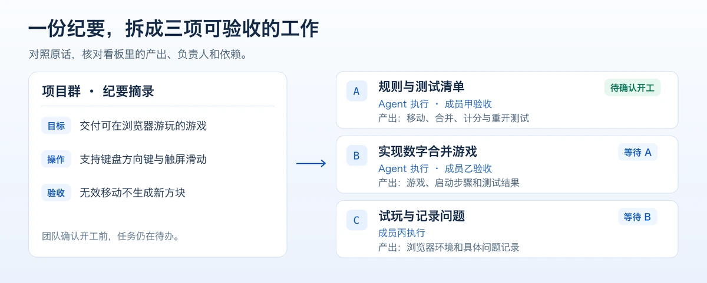
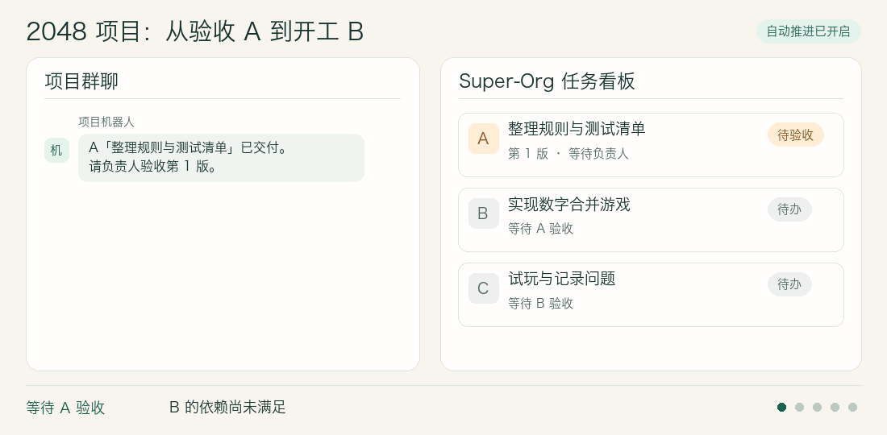

# 2048 项目教程

用 Super-Org 协作交付一个 2048 风格的浏览器数字合并游戏。你会从一份会议纪要建立项目，交给 Agent 整理规则，再由负责人验收这份清单。验收解除依赖后，Agent 开始实现游戏。最后由团队实际试玩并验收。


| 任务 | 谁执行 | 什么时候可以开始 |
| --- | --- | --- |
| A · 整理规则与测试清单 | Agent，成员甲验收 | 团队确认开工后 |
| B · 实现数字合并游戏 | Agent，成员乙验收 | A 验收通过后 |
| C · 试玩与记录问题 | 成员丙 | B 验收通过后 |

## 1. 准备一个测试群

1. 启动完整服务，打开「Agent 状态」，确认 Agent 可接单。完整服务默认工作台地址为 `http://127.0.0.1:3082/orchestrator/projects`，自定义端口时替换地址中的端口。
2. 选用团队平时使用的 IM 建立测试群。用已接入的项目群可直接发送消息。使用其他 IM 时，可以先在群里讨论，再在工作台建立项目、录入行动项、开工和验收。工作台使用同一项目状态与后续推进机制。此教程可以先留空 GitHub 仓库。
3. 在团队名册登记参与者。走已接入的群聊入口时，参与者需完成身份登记，确保 Agent 可以按实际账号确认分工和验收。当前完整服务支持钉钉项目群的首次纪要与群内操作。 [部署与运维](../deployment.zh-CN.md)

## 2. 提交纪要，让行动项出现在看板



把下面的「成员甲／乙／丙」替换为名册里的姓名。在已接入的项目群，由已登记成员 @ 机器人并粘贴纪要。走工作台入口时，创建待开工项目，再按同一份纪要填写目标、三项任务、分工与依赖。

```text
项目会议纪要
项目名称：2048 数字合并游戏

目标：交付一个可以在浏览器游玩的数字合并游戏，支持键盘和触屏。

A：整理移动、合并、计分与重新开始的规则和测试清单。交给 Agent，成员甲验收。
B：按清单实现游戏，提供启动步骤和测试结果。交给 Agent，成员乙验收。依赖 A 验收通过。
C：用浏览器做一轮人工试玩，记录操作环境和发现的问题。由成员丙执行。依赖 B 验收通过。

重点检查：每个方块一轮只能合并一次；无效移动不产生新方块；重新开始清空本局分数。
```

收到整理结果后打开新项目。核对目标、三张任务卡、负责人和 **A → B → C** 的依赖。此时项目应显示**待开工**。有缺项就引用对应任务补充，例如「B 的验收条件加上触屏滑动，先更新任务」。打开 B 的详情检查实际变更。

## 3. 确认开工并执行 A

打开「编辑项目」，开启**自动推进**。然后在已接入的项目群 @ 机器人发送，或在工作台确认开工并对 A 点击「交给 Agent」：

> 我们确认这个项目开工。请先让 Agent 完成「整理规则与测试清单」，把清单交给这项任务的负责人验收。

打开 A 的任务详情，在「Agent 执行」查到当前工单。A 此时是**进行中**，B 仍在等待 A 验收。A 的 Agent 提交成功报告后，任务变为**待验收**，在绑定的项目群，机器人会通知负责人验收并附上交付结果与版本。若工单还在排队或受阻，先看实际执行记录和需要谁处理的问题。

## 4. 验收 A，观察 B 自动开工

由 A 的负责人打开报告，确认本版清单覆盖合并、无效移动和重开。在工作台点击本版的「验收通过」并填写依据，或在已接入的项目群**引用当前版验收通知**，@ 机器人回复：

> 我核对了第 1 版清单，合并、无效移动和重开都有检查项，这版验收通过。



上图是演示动画，示例中的消息经过简化。完成这一步后，从左栏打开「推进记录」，按下面的顺序核对自己的项目：

| 看到的变化 | 去哪里确认 |
| --- | --- |
| A 第 1 版验收通过，A 变为**完成** | A 的「交付与验收」及 `review.accepted` |
| B 解除对 A 的依赖 | B 的 `task.ready` 及其关联的 Agent 判断 |
| Agent 开始 B | B 变为**进行中**，任务详情有实际工单，推进记录有 `task.start` 工具结果 |

B 的自动开工取决于项目有效授权、任务内容和运行条件。没有开工时，先查推进记录里是否有就绪事件、Agent 提问或工具错误。若出现运行阻塞，在原工单补充信息即可继续处理。


如果 A 的清单缺少检查项，可以引用同一版并说明具体缺项。确认新交付后，引用新版通知提交决定。两个版本的记录都可以在任务详情查看。

## 5. 试玩交付结果，完成项目验收

等 B 交付后，按实际报告给出的地址或命令打开游戏。分别验证键盘、触屏、计分、无效移动和重开。由成员乙验收 B 的当前交付，随后由成员丙完成 C 的人工试玩。C 可以直接在看板提交实际试玩记录和截图供确认。

在「推进记录」回看一遍：哪条纪要形成分工、谁验收了哪一版、为什么下一项开始、工单实际交付了什么。可以用同样的流程试第二个项目。

有仓库时，可以给 B 关联 Issue，选择 PR 交付，并验证评论继续原工单、合并后请求人工验收、通过后同步关闭「负责解决」的 Issue。具体条件和反例见[2048 人工验收清单](../2048-manual-acceptance.zh-CN.md#pr-评论代码交付与-issue-同步)。
